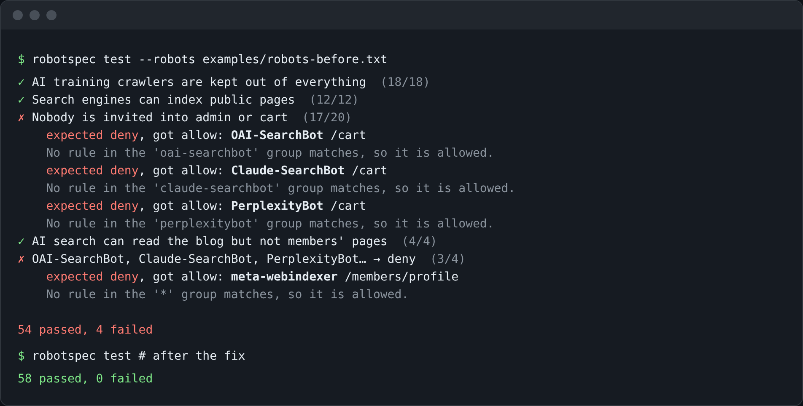
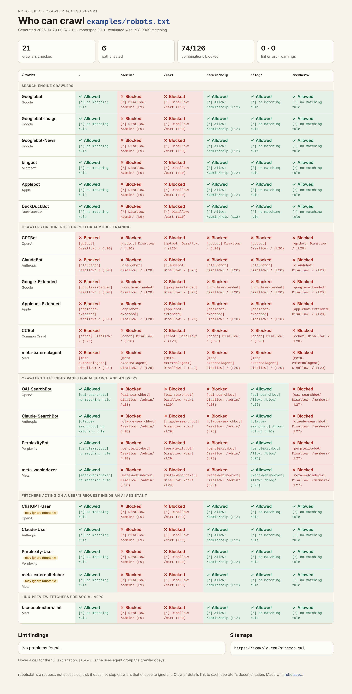
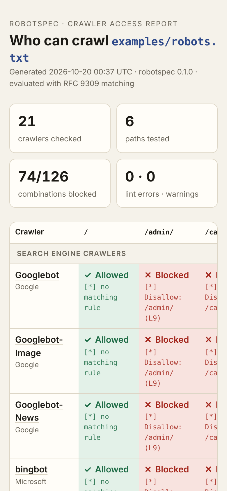
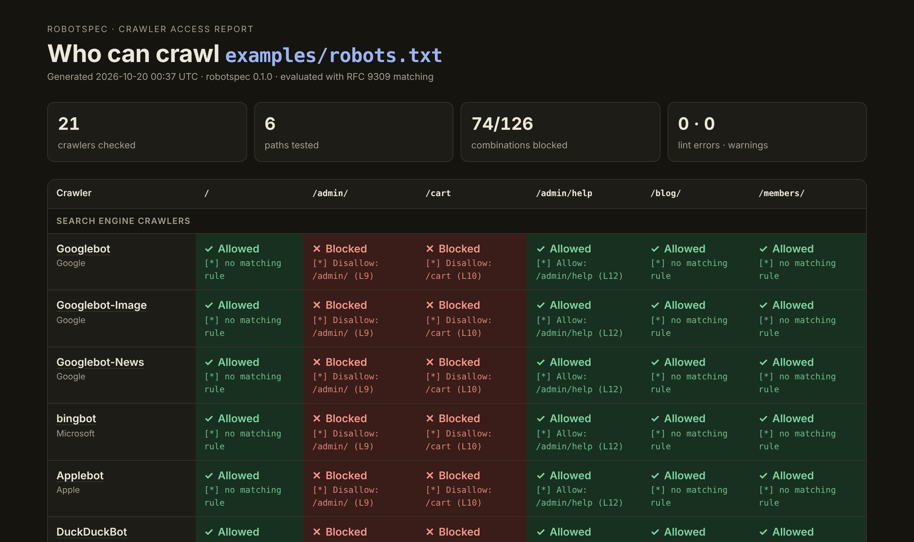
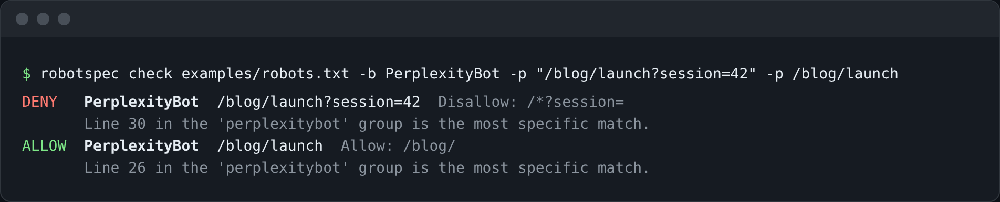

# robotspec

[](https://github.com/iamnarace/robotspec/actions/workflows/ci.yml)

**Test your robots.txt like code.** robotspec evaluates a `robots.txt` with [RFC 9309](https://datatracker.ietf.org/doc/rfc9309/) matching rules, shows which crawlers (search engines, AI training bots, AI search and assistant fetchers) can reach which paths, explains every decision down to the line, and fails your CI build when an edit changes who can crawl what.



## Why

`robots.txt` looks simple, but its rules are easy to get wrong and the cost of a mistake is invisible until traffic or search rankings change:

- **Groups don't inherit.** A crawler with its own `User-agent` group ignores the `*` group completely, so adding a group for `PerplexityBot` silently unblocks everything you only disallowed under `*`. (The screenshot above is exactly this bug.)
- **The longest match wins, not the first.** `Disallow: /*?session=` beats `Allow: /blog/` for `/blog/post?session=1` because it is longer.
- **There are now dozens of crawlers.** Blocking AI *training* (GPTBot, ClaudeBot, Google-Extended…) without accidentally blocking *search* (Googlebot, bingbot, Applebot…) means checking many user agents at once, and some crawlers fall back to another bot's rules (Applebot follows `Googlebot` rules when it has no group of its own).
- **Google retired its robots.txt Tester in 2023**, and most online checkers test one URL and one bot at a time against a live site.

robotspec turns your intent into a small policy file that lives next to `robots.txt` and runs in CI, so the rules you meant are the rules you ship.

## Features

- **RFC 9309 evaluation**: longest-match precedence (allow wins ties), `*` and `$` wildcards, percent-encoding normalisation, merging of duplicate groups, `/robots.txt` always allowed, and the 4xx-means-allow / 5xx-means-disallow fetch rules.
- **Explanations, not just yes/no**: every verdict names the group used and the exact line that decided it.
- **Crawler catalogue**: 21 well-known crawlers in five categories, each linked to its operator's documentation, including fallback chains (Googlebot-Image → Googlebot, Applebot → Googlebot) and flags for fetchers whose operators say they may not follow robots.txt.
- **Access matrix** of crawlers × paths as terminal text, Markdown, JSON or a standalone HTML report (light and dark).
- **Policy tests** (`robotspec.toml`) with bot categories, custom tokens and requirements such as "must declare a Sitemap"; exit code 1 on failure; writes a summary to `$GITHUB_STEP_SUMMARY` automatically in GitHub Actions.
- **`robotspec init`** snapshots today's behaviour into a policy, so any future change is caught.
- **Linter** for typos (`Dissallow`), rules before any `User-agent`, unsupported directives (`Crawl-delay`, `Noindex`), relative paths, misplaced `$`, oversized files and more.
- **No dependencies** beyond the Python 3.11+ standard library. Works offline on local files; can also fetch a live site.

| HTML report | Phone width |
|---|---|
|  |  |



## Install

Prerequisites: Python 3.11 or newer.

robotspec is not on PyPI yet. Install it from GitHub:

```bash
pip install "git+https://github.com/iamnarace/robotspec.git"
```

Or from a clone:

```bash
git clone https://github.com/iamnarace/robotspec.git
cd robotspec
pip install .
```

## Usage

### Explain a decision

```bash
robotspec check public/robots.txt -b GPTBot -b Googlebot -p /blog/post -p /admin/
```



`SOURCE` can be a file, `-` for stdin, or a site URL (`https://example.com` fetches `https://example.com/robots.txt`). `-b` accepts a catalogue name, `category:ai-training`, or `token:AnyCrawler` for a crawler that isn't in the catalogue.

### See the whole picture

```bash
robotspec matrix public/robots.txt                       # all crawlers, '/' plus paths named in the file
robotspec matrix public/robots.txt -c ai-training -c search -p / -p /blog/
robotspec matrix https://example.com -f html -o robots-report.html
robotspec matrix public/robots.txt -f markdown          # paste into a PR description
```

### Lock in your policy and test it in CI

```bash
robotspec init public/robots.txt      # writes robotspec.toml from current behaviour
robotspec test                        # exit 0 if everything matches, 1 if not
```

A hand-written policy reads like a spec:

```toml
robots = "public/robots.txt"          # relative to this file; a URL also works

[[expect]]
name = "AI training crawlers are kept out of everything"
bots = ["category:ai-training"]
paths = ["/", "/blog/launch-notes"]
access = "deny"

[[expect]]
name = "Search engines can index public pages"
bots = ["Googlebot", "bingbot", "Applebot"]
paths = ["/", "/blog/launch-notes"]
access = "allow"

[require]
sitemap = true          # a Sitemap line must exist
no_lint_errors = true   # typos and rules before User-agent fail the build
```

The repository's [`examples/`](examples/) folder has a full policy, a buggy `robots-before.txt` and the fixed `robots.txt`.

GitHub Actions:

```yaml
- uses: actions/setup-python@v5
  with:
    python-version: "3.12"
- run: pip install "git+https://github.com/iamnarace/robotspec.git"
- run: robotspec test          # also writes a Markdown summary to the job page
```

### Other commands

```bash
robotspec lint public/robots.txt [--strict]   # --strict fails on warnings too
robotspec bots [-c ai-user]                   # list the catalogue with sources
```

Exit codes: `0` success, `1` a policy or lint failure, `2` bad input (missing file, invalid policy, unknown bot).

## How decisions are made

1. **Pick the group.** The crawler's tokens are tried in order (for example `Applebot`, then `Googlebot`). Matching is case-insensitive and groups that name the same token are merged. If none matches, the `*` group is used; if there is no `*` group, everything is allowed.
2. **Pick the rule.** Every Allow/Disallow pattern in that group is matched against the URL path and query, after percent-encoding normalisation. The longest pattern (in octets) wins; on a tie, Allow wins. No match means allowed.
3. **Special cases.** `/robots.txt` itself is always allowed. When fetching a URL, an HTTP 4xx response (or more than five redirects) means "allow everything" and a 5xx response or network error means "disallow everything", as RFC 9309 §2.3.1 requires.

"Longest match" is measured by pattern length, as in Google's reference parser. Crawlers may differ in edge cases the RFC leaves open; robotspec documents what it does rather than guessing what each vendor does.

## Development

```bash
python -m venv .venv && . .venv/bin/activate
pip install -e ".[dev]"
pytest                     # 88 tests
ruff check . && ruff format --check .
mypy                       # strict mode
python -m build            # sdist and wheel in dist/
```

Screenshots are generated from real output with `python scripts/capture_screenshots.py` (needs `pip install playwright && playwright install chromium`).

Project layout:

```
src/robotspec/
  matcher.py    percent-encoding normalisation, wildcard matching, specificity
  parser.py     robots.txt -> groups, sitemaps and lint findings
  evaluate.py   group selection and rule precedence -> Verdict
  bots.py       sourced crawler catalogue
  policy.py     robotspec.toml loading, running and `init` snapshots
  source.py     file/stdin/URL loading with RFC 9309 status handling
  render.py     text, Markdown, JSON and HTML output
  cli.py        argparse commands
tests/          matcher, parser/evaluation, policy, CLI and HTTP-fetch tests
```

## Privacy and security

- robotspec makes no network requests unless you pass a URL. Then it fetches only that site's `/robots.txt`, identifying itself as `robotspec/<version> (+https://github.com/iamnarace/robotspec)`, and reads at most 500 KiB.
- No telemetry, no configuration outside your project.
- **robots.txt is not access control.** It asks crawlers to stay away; it does not stop ones that ignore it. Protect private content with authentication.

## Known limitations

- The catalogue is hand-maintained and was last reviewed on 2026-10-20. Crawler names and behaviour change; corrections with a link to the operator's documentation are very welcome.
- Vendor-specific extensions (`Crawl-delay`, `Clean-param`, `Content-Signal`) are reported but not evaluated.
- Real crawlers can differ from RFC 9309 in corner cases (for example, how they treat HTTP 429 or partial-token user-agent matches). robotspec follows the RFC and documents its choices.
- Not yet published to PyPI, and no packaged GitHub Action; use the `pip install git+…` step shown above.

## Roadmap

- Publish to PyPI and offer a reusable GitHub Action.
- `robotspec diff old.txt new.txt` to show which verdicts changed between two versions.
- Optional checks of `X-Robots-Tag` headers and `<meta name="robots">` on sample URLs.
- Community-maintained catalogue updates with a review checklist.

## Contributing

Bug reports, catalogue corrections and pull requests are welcome; see [CONTRIBUTING.md](CONTRIBUTING.md). Please report security issues privately as described in [SECURITY.md](SECURITY.md).

## Research and references

The background research, comparable tools and design decisions are in [docs/RESEARCH.md](docs/RESEARCH.md). Key references:

- [RFC 9309: Robots Exclusion Protocol](https://datatracker.ietf.org/doc/rfc9309/)
- Crawler documentation from [Google](https://developers.google.com/crawling/docs/crawlers-fetchers/google-common-crawlers), [OpenAI](https://developers.openai.com/api/docs/bots), [Anthropic](https://support.claude.com/en/articles/8896518), [Apple](https://support.apple.com/119829), [Perplexity](https://docs.perplexity.ai/docs/resources/perplexity-crawlers), [Meta](https://developers.facebook.com/docs/sharing/webmasters/web-crawlers) and [Common Crawl](https://commoncrawl.org/faq)

## Licence

[MIT](LICENSE) © 2026 Naresh Adhikari.

Developed with assistance from Claude.
